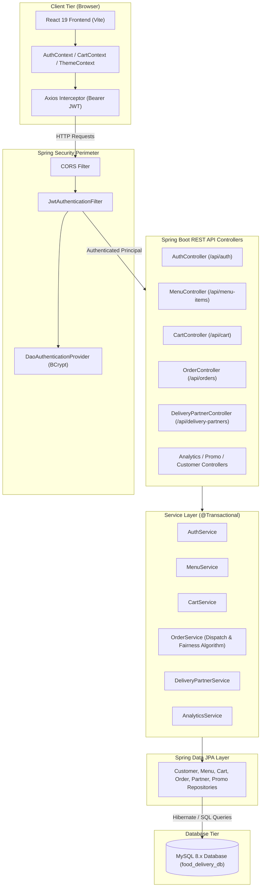
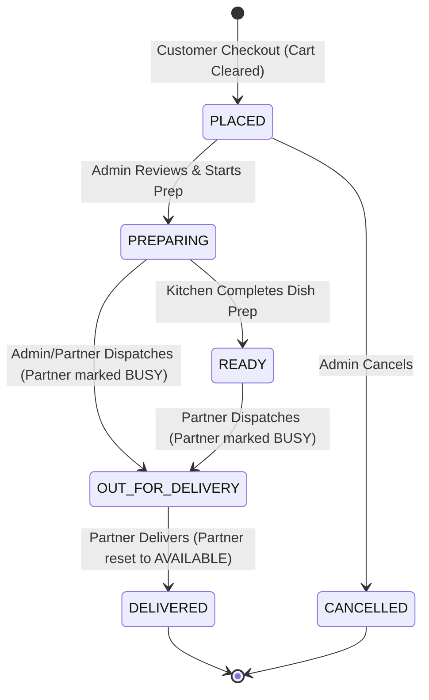
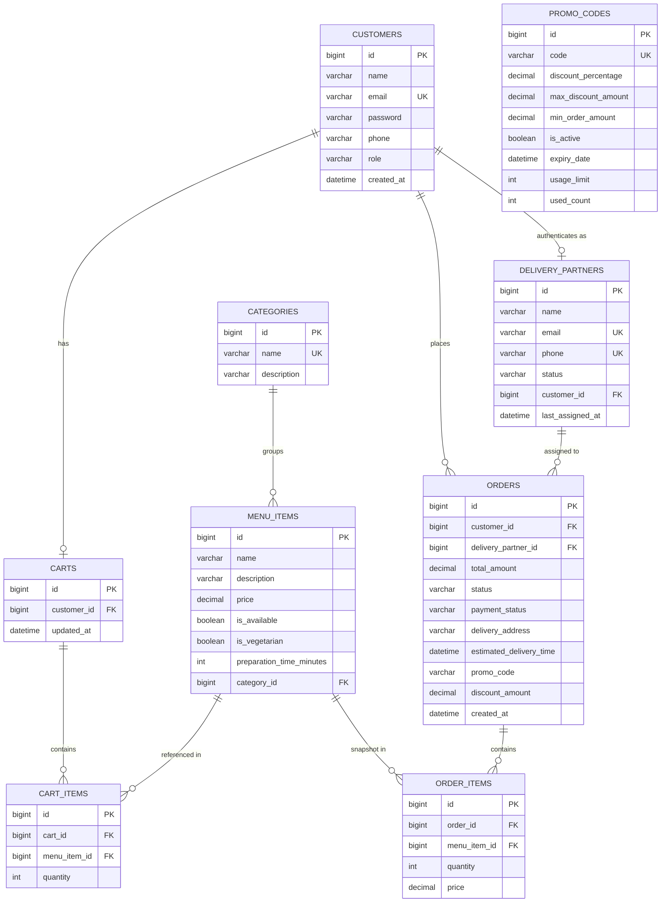

# FlavorsExpress — Single-Restaurant Food Delivery System

[](https://openjdk.org/)
[](https://spring.io/projects/spring-boot)
[](https://react.dev/)
[](https://vitejs.dev/)
[](https://tailwindcss.com/)
[](https://www.mysql.com/)
[](https://jwt.io/)

FlavorsExpress is a full-stack, single-restaurant food ordering and delivery management system designed for the contemporary Indian quick-service dining market. Built with **Spring Boot** and **Spring Security** on the backend and **React 19** with **Vite** and **Tailwind CSS v4** on the frontend, the platform features authentic Indian fast-food menus, full Indian Rupee (INR / `₹`) localization, complete light/dark theming, automated and manual dispatch assignment, promo discount verification, live order tracking with preparation ETAs, and a comprehensive business analytics dashboard.

---

## Table of Contents

- [Project Overview](#project-overview)
- [Project Screenshots](#project-screenshots)
- [Key Features](#key-features)
  - [Customer Portal](#customer-portal)
  - [Admin Dashboard](#admin-dashboard)
  - [Delivery Partner Portal](#delivery-partner-portal)
  - [Platform \& Cross-Cutting](#platform--cross-cutting)
- [Technology Stack](#technology-stack)
- [Application Architecture](#application-architecture)
- [Order Lifecycle](#order-lifecycle)
- [Role-Based Access Control (RBAC)](#role-based-access-control-rbac)
- [Project Directory Structure](#project-directory-structure)
- [Prerequisites and Installation](#prerequisites-and-installation)
  - [1. Clone and Prepare Database](#1-clone-and-prepare-database)
  - [2. Backend Setup](#2-backend-setup)
  - [3. Frontend Setup](#3-frontend-setup)
- [Environment Variables](#environment-variables)
- [API Documentation](#api-documentation)
- [Testing and Build Commands](#testing-and-build-commands)
- [Database Model](#database-model)
- [Security and Data Integrity](#security-and-data-integrity)
- [Project Scope and Limitations](#project-scope-and-limitations)
- [Future Enhancements](#future-enhancements)
- [Contributors and License](#contributors-and-license)

---

## Project Overview

FlavorsExpress is developed as a dedicated food delivery application for a single restaurant enterprise. It addresses the complete lifecycle of modern quick-service food operations:

1. **Consumers** can browse authentic Indian fast-food dishes (Mumbai street favourites, gourmet burgers, aromatic biryanis, tandoori pizzas, and desserts), filter by dietary preference (Veg / Non-Veg), assemble orders with dynamic quantity steppers, validate discount coupons, and track delivery progress in real time.
2. **Kitchen Administrators** oversee order queues, monitor real-time business KPIs (lifetime revenue, order velocity, top dishes), manage menu offerings and promo codes, and assign deliveries using automated round-robin fairness scheduling or manual dispatch.
3. **Delivery Partners** manage their work availability (`AVAILABLE`, `BUSY`, `OFFLINE`), receive dispatch assignments, inspect customer delivery destinations, and transition orders through delivery milestones with automatic availability restoration upon completion.

---

## Project Screenshots

> **Note on Screenshots:** Place application screenshots in the `docs/screenshots/` directory matching the filenames below for visual evaluation.

| View | Description | Suggested Screenshot File |
| :--- | :--- | :--- |
| **Homepage** | Two-column food hero, category carousel, featured bestsellers, and promo banner | `docs/screenshots/01-homepage.png` |
| **Menu Browsing** | Indian fast-food cards with food photography, Veg/Non-Veg badges, INR prices, and quantity steppers | `docs/screenshots/02-menu-browsing.png` |
| **Cart & Checkout** | Itemized bill breakdown, promo code discount preview, delivery address input, and INR totals | `docs/screenshots/03-cart-checkout.png` |
| **Order Tracking** | 4-step timeline (`PLACED` &rarr; `PREPARING` &rarr; `OUT_FOR_DELIVERY` &rarr; `DELIVERED`), prep-time ETA, and driver info | `docs/screenshots/04-order-tracking.png` |
| **Admin Dashboard** | Business KPIs, live dispatch table, menu item CRUD, and promo code management | `docs/screenshots/05-admin-dashboard.png` |
| **Delivery Dashboard** | Availability status toggle (`AVAILABLE` / `BUSY` / `OFFLINE`), assigned order cards, and delivery actions | `docs/screenshots/06-delivery-partner-dashboard.png` |
| **Light & Dark Themes** | Side-by-side comparison illustrating warm ivory surfaces vs. rich charcoal dark mode | `docs/screenshots/07-light-dark-themes.png` |

---

## Key Features

### Customer Portal
- **Indian Fast-Food Menu:** Authentic culinary selection spanning Mumbai street food (Vada Pav, Pav Bhaji), craft burgers and wraps, dum-cooked biryanis, tandoori pizzas, and Indian desserts.
- **Dietary Indicators:** Standardized Indian vegetarian (green square & circle) and non-vegetarian (red/brown square & triangle) visual indicators derived from entity properties.
- **Search & Multi-Category Filtering:** Real-time search across dish titles and descriptions, category switching, and instant veg/non-veg filtering.
- **Cart Management:** Persistent backend-backed cart with optimistic quantity increments/decrements, item removal, and subtotal calculation.
- **Promo Codes & Discount Preview:** Instant validation against active promotional rules with live display of calculated INR savings and discounted payable amounts.
- **Checkout Flow:** Simple, validated address submission with anti-double-submission state protection and automatic cart clearance.
- **Order Tracking & History:** Itemized customer history with live 4-stage progression bar, preparation-time-based estimated delivery time (ETA), and assigned driver contact details.

### Admin Dashboard
- **Business Performance Analytics:** Interactive KPI overview displaying lifetime revenue, total order volume, today's order velocity, today's revenue, active delivery partners, order status distribution breakdown, and the top-selling items leaderboard.
- **Live Dispatch Control:** Real-time monitoring of all orders with one-click automated assignment (using an availability and fairness round-robin algorithm) or manual courier assignment from available staff.
- **Order Status Transitions:** Operational control to move orders between `PLACED`, `PREPARING`, `READY`, `OUT_FOR_DELIVERY`, `DELIVERED`, and `CANCELLED`.
- **Menu & Category Management:** Complete administrative CRUD interface for menu items (name, description, category, price in INR, vegetarian flag, preparation time in minutes, availability status) and categories.
- **Promo Code Management:** Comprehensive CRUD operations to define coupon codes, percentage discount rates, minimum order values in INR, maximum discount caps in INR, usage limits, and expiration dates.

### Delivery Partner Portal
- **Work Availability Management:** Dedicated status toggle allowing partners to switch between `AVAILABLE`, `BUSY`, and `OFFLINE`.
- **Active Delivery Lock:** Prevents drivers from switching to `OFFLINE` while actively carrying an assigned delivery order.
- **Assigned Order Queue:** Live listing of assigned orders with customer name, contact phone number, destination delivery address, item list, and payable cash/order total.
- **Delivery Milestone Updates:** Fast action triggers allowing drivers to mark orders `OUT_FOR_DELIVERY` and `DELIVERED`.
- **Automatic Status Release:** Transitioning an order to `DELIVERED` automatically releases the delivery partner back into the `AVAILABLE` pool for subsequent dispatch.

### Platform & Cross-Cutting
- **INR Currency Localization:** All price tags, calculations, sub-totals, discounts, delivery fees, and grand totals are formatted in Indian Rupees (`₹`) using locale-aware whole-number formatting (`en-IN`).
- **Complete Light and Dark Themes:** Comprehensive theme engine supporting warm ivory surfaces in light mode and deep slate/charcoal in dark mode with persistent user choice in `localStorage`, system `prefers-color-scheme` fallback, and a `<head>` pre-render script to eliminate theme flash.
- **Strict Role-Based Security:** Spring Security 6 with stateless JWT tokens enforcing distinct customer, administrator, and delivery partner operational boundaries.
- **Insecure Direct Object Reference (IDOR) Protection:** Server-side identity derivation and ownership validation ensuring users can only read or modify their own carts and orders.

---

## Technology Stack

| Layer | Technology | Version | Purpose |
| :--- | :--- | :--- | :--- |
| **Backend Framework** | Spring Boot | 4.1.0 | Core application framework, dependency injection, and REST controllers |
| **Language / Runtime** | Java | 21 (LTS) | Modern language features (records, pattern matching, switch expressions) |
| **Security** | Spring Security | 6.x | Stateless authentication, authorization filter chain, and CORS management |
| **JWT Library** | io.jsonwebtoken (JJWT) | 0.12.6 | HMAC-SHA512 token creation, signing, and request claim parsing |
| **Persistence / ORM** | Spring Data JPA / Hibernate | 6.x | Relational mapping, repository abstraction, and transactional execution |
| **Database** | MySQL | 8.x | Primary relational database storage |
| **Database Driver** | MySQL Connector/J | 9.x | JDBC driver for database connectivity |
| **API Documentation** | Springdoc OpenAPI UI | 2.8.5 | OpenAPI 3.0 specification and interactive Swagger UI console |
| **Code Generation** | Project Lombok | 1.18.x | Boilerplate reduction (getters, setters, builders, logging) |
| **Validation** | Jakarta Bean Validation | 3.0 | Declarative input validation on incoming DTOs and entities |
| **Frontend Framework** | React | 19.2.8 | Declarative component UI library |
| **Frontend Tooling** | Vite | 8.2.0 | Next-generation fast frontend bundler and development server |
| **Routing** | React Router DOM | 7.18.2 | Client-side page navigation and role-based route guards |
| **Styling** | Tailwind CSS & @tailwindcss/vite | 4.3.3 | Utility-first CSS engine with dark mode variant support |
| **Icons** | Lucide React | 1.28.0 | Clean, consistent SVG icon system |
| **HTTP Client** | Axios | 1.19.0 | Promise-based HTTP client configured with JWT request interceptors |

---

## Application Architecture



---

## Order Lifecycle

The order fulfillment workflow models an authentic quick-service restaurant delivery pipeline. State transitions are governed by role-specific access permissions and transactional database boundaries:



### Transition Steps & Responsibilities

1. **Order Placement (`PLACED`):**
   - **Actor:** `CUSTOMER`
   - Customer initiates checkout from `/checkout`. The backend verifies cart contents, recalculates item prices, verifies promo discount rules, computes the order subtotal, records the order, and empties the customer's cart atomically.
2. **Order Preparation (`PREPARING`):**
   - **Actor:** `ADMIN`
   - Kitchen administration reviews incoming placed orders in the dispatch console and advances the status to indicate the kitchen has commenced cooking.
3. **Delivery Partner Assignment:**
   - **Actor:** `ADMIN`
   - **Automated Assignment:** Selects the delivery partner with status `AVAILABLE` who has been idle the longest (least recently assigned) to ensure fair workload distribution.
   - **Manual Assignment:** Allows the admin to assign any specific available partner from the dropdown list.
4. **Out for Delivery (`OUT_FOR_DELIVERY`):**
   - **Actor:** `DELIVERY_PARTNER` or `ADMIN`
   - The delivery partner collects the packaged food from the kitchen counter and marks the order `OUT_FOR_DELIVERY`. The assigned delivery partner is automatically transitioned to `BUSY`.
5. **Final Delivery (`DELIVERED`):**
   - **Actor:** `DELIVERY_PARTNER`
   - Upon handing the package to the customer, the driver marks the delivery complete. The backend marks the order `DELIVERED` and automatically restores the partner's status to `AVAILABLE`.

---

## Role-Based Access Control (RBAC)

FlavorsExpress enforces strict multi-role separation across both client-side navigation and backend REST controllers.

### Role Definitions

| Role | Database Authority | Intended User | Core Capabilities |
| :--- | :--- | :--- | :--- |
| **`CUSTOMER`** | `ROLE_CUSTOMER` | Dining Customers | Browse menu, search, filter, manage cart, redeem promo codes, place orders, track personal orders |
| **`ADMIN`** | `ROLE_ADMIN` | Restaurant Managers | Manage menu items & categories, create promo codes, monitor dispatch queue, assign delivery partners, view analytics |
| **`DELIVERY_PARTNER`** | `ROLE_DELIVERY` | Delivery Couriers | Manage work availability (`AVAILABLE` / `BUSY` / `OFFLINE`), inspect assigned orders, update delivery progress |

### Account Provisioning
1. **Public Registration (`/register`):** Allows self-service registration for `CUSTOMER` and `DELIVERY_PARTNER` roles. Registering as a delivery partner automatically creates both a `Customer` credentials record with role `DELIVERY_PARTNER` and a corresponding `DeliveryPartner` profile linked via a foreign key relation.
2. **Initial Administrator Provisioning:** System administrator accounts cannot be arbitrarily self-registered via public endpoints. They are provisioned via:
   - Automated bootstrap configuration in `application.properties` (enabled via `BOOTSTRAP_ADMIN_ENABLED=true` with `BOOTSTRAP_ADMIN_EMAIL` and `BOOTSTRAP_ADMIN_PASSWORD`), or
   - Seeded database credentials during initialization.

### Route Protection vs. Backend Authorization
- **Frontend Route Guards (`ProtectedRoute.jsx`):** Examines the current user's role stored in `AuthContext` and smoothly redirects unauthorized users to their respective home dashboard without rendering private components.
- **Backend API Authorization (`SecurityConfig.java`):** Inspects incoming JWT claims on every HTTP request and verifies authorities at the servlet filter level.
- **Identity Derivation & Ownership (`SecurityUtils.java`):** Endpoints that modify carts, view personal orders, or update partner availability dynamically extract the authenticated principal from the Spring Security context, rendering URL tampering and IDOR attacks impossible.

---

## Project Directory Structure

```
FDS/
├── .env.example                     # Root backend environment template
├── pom.xml                          # Maven build configuration and dependencies
├── mvnw / mvnw.cmd                  # Cross-platform Maven wrapper scripts
├── src/
│   ├── main/
│   │   ├── java/com/pratham/FDS/
│   │   │   ├── config/              # SecurityConfig, OpenApiConfig, DataInitializer, DotenvInitializer
│   │   │   ├── controller/          # REST Controllers (Auth, Menu, Cart, Order, Partner, Promo, Analytics)
│   │   │   ├── dto/                 # Request payloads, response DTOs, and paged projections
│   │   │   ├── entity/              # JPA Entities (Customer, DeliveryPartner, MenuItem, Cart, Order, Promo)
│   │   │   ├── enums/               # OrderStatus, DeliveryPartnerStatus, PaymentStatus, UserRole
│   │   │   ├── exception/           # GlobalExceptionHandler and custom error definitions
│   │   │   ├── mapper/              # Entity-to-DTO and DTO-to-Entity mapping helpers
│   │   │   ├── repository/          # Spring Data JPA interfaces with custom JPQL queries
│   │   │   ├── security/            # JwtAuthenticationFilter, JwtUtil, CustomUserDetailsService, SecurityUtils
│   │   │   └── service/             # Business interfaces and transactional implementations
│   │   └── resources/
│   │       ├── application.properties # Spring configuration with environment variable placeholders
│   │       └── static/              # Static documentation resources
│   └── test/
│       └── java/com/pratham/FDS/    # 55 automated integration & unit tests
└── frontend/
    ├── .env.example                 # Frontend Vite environment template
    ├── package.json                 # Node dependencies and scripts
    ├── vite.config.js               # Vite bundler configuration with Tailwind plugin
    ├── index.html                   # HTML entrypoint with anti-theme-flash script
    └── src/
        ├── api/                     # Axios instance configured with JWT request interceptors
        ├── components/              # Shared UI components (Navbar, Footer, ProtectedRoute, VegIndicator)
        ├── context/                 # React Contexts (AuthContext, CartContext, ThemeContext)
        ├── pages/                   # Application screens (Home, Menu, Cart, Checkout, Orders, Dashboards)
        ├── utils/                   # Shared utilities (currency formatting, food image mapping)
        ├── index.css                # Global styles, Tailwind v4 imports, and theme tokens
        └── App.jsx                  # Main router configuration and layout wrapper
```

---

## Prerequisites and Installation

### System Requirements
- **Java Development Kit (JDK):** Version 21 (LTS)
- **Node.js:** Version 18.x or 20.x+
- **Package Manager:** `npm` 9.x+
- **Database Engine:** MySQL Server 8.0 or higher
- **Build Tool:** Maven (bundled via `./mvnw` / `.\mvnw.cmd`)

---

### 1. Clone and Prepare Database

1. Clone the repository to your local development environment:
   ```bash
   git clone https://github.com/Pratham-Mishra225/FlavorsExpress.git
   cd FlavorsExpress
   ```

2. Start your local MySQL service and initialize the schema:
   ```sql
   CREATE DATABASE IF NOT EXISTS food_delivery_db;
   ```

---

### 2. Backend Setup

1. Copy the root environment template to `.env`:
   ```bash
   # Linux / macOS
   cp .env.example .env

   # Windows PowerShell
   Copy-Item .env.example .env
   ```

2. Open `.env` in your editor and configure your MySQL credentials and a 512-bit JWT secret:
   ```env
   DB_URL=jdbc:mysql://localhost:3306/food_delivery_db?createDatabaseIfNotExist=true&serverTimezone=UTC&useSSL=false&allowPublicKeyRetrieval=true
   DB_USERNAME=your_mysql_username
   DB_PASSWORD=your_mysql_password
   SERVER_PORT=8080
   JWT_SECRET=your_base64_encoded_512_bit_hmac_secret_key
   JWT_EXPIRATION=86400000
   CORS_ALLOWED_ORIGINS=http://localhost:5173,http://127.0.0.1:5173
   ```

3. Launch the Spring Boot backend server:
   ```bash
   # Linux / macOS
   ./mvnw spring-boot:run

   # Windows
   .\mvnw.cmd spring-boot:run
   ```
   The backend API will start on `http://localhost:8080`.

---

### 3. Frontend Setup

1. Navigate to the `frontend` directory:
   ```bash
   cd frontend
   ```

2. Copy the frontend environment template to `.env`:
   ```bash
   # Linux / macOS
   cp .env.example .env

   # Windows PowerShell
   Copy-Item .env.example .env
   ```

3. Verify `frontend/.env` points to the running backend:
   ```env
   VITE_API_BASE_URL=http://localhost:8080/api
   VITE_APP_NAME=FlavorsExpress
   ```

4. Install dependencies and start the Vite development server:
   ```bash
   npm install
   npm run dev
   ```
   The frontend application will be live at `http://localhost:5173`.

---

## Environment Variables

### Backend Variables (Root `.env`)

| Variable Name | Description | Required? | Default / Example Value |
| :--- | :--- | :---: | :--- |
| `DB_URL` | JDBC connection URL for MySQL with SSL and timezone parameters | No | `jdbc:mysql://localhost:3306/food_delivery_db?...` |
| `DB_USERNAME` | MySQL database username | **Yes** | `root` |
| `DB_PASSWORD` | MySQL database user password | **Yes** | `your_secure_password` |
| `SERVER_PORT` | HTTP server listening port | No | `8080` |
| `JWT_SECRET` | Base64-encoded secret key for signing HMAC-SHA512 JWTs | **Yes** | `dGhpcy1pcy1hLXNhbXBsZS1zZWNyZXQta2V5...` |
| `JWT_EXPIRATION` | Token validity duration in milliseconds | No | `86400000` (24 hours) |
| `CORS_ALLOWED_ORIGINS` | Comma-separated list of allowed frontend origin URLs | No | `http://localhost:5173,http://127.0.0.1:5173` |
| `BOOTSTRAP_ADMIN_ENABLED` | Flag to provision an administrator account on initial startup | No | `false` |
| `BOOTSTRAP_ADMIN_EMAIL` | Email for bootstrapped administrator account | No | `admin@flavorsexpress.com` |
| `BOOTSTRAP_ADMIN_PASSWORD` | Initial password for bootstrapped administrator account | No | `AdminPass123!` |

> **Configuration Loading:** Spring Boot loads the root `.env` via `DotenvInitializer` before context initialization. System environment variables take precedence over `.env` files.

---

### Frontend Variables (`frontend/.env`)

| Variable Name | Description | Required? | Default / Example Value |
| :--- | :--- | :---: | :--- |
| `VITE_API_BASE_URL` | Base URL of the backend REST API | **Yes** | `http://localhost:8080/api` |
| `VITE_APP_NAME` | Display name of the application | No | `FlavorsExpress` |

---

## API Documentation

Interactive Swagger documentation is available at:
- **Swagger UI Console:** [http://localhost:8080/swagger-ui.html](http://localhost:8080/swagger-ui.html)
- **OpenAPI 3 JSON Spec:** [http://localhost:8080/v3/api-docs](http://localhost:8080/v3/api-docs)

### Endpoint Reference

#### 1. Authentication
| Method | Path | Description | Access / Role |
| :--- | :--- | :--- | :--- |
| `POST` | `/api/auth/register` | Register a new customer or delivery partner account | Public |
| `POST` | `/api/auth/login` | Authenticate with email/password and obtain a JWT | Public |

#### 2. Menu Items
| Method | Path | Description | Access / Role |
| :--- | :--- | :--- | :--- |
| `GET` | `/api/menu-items` | Get paginated dishes with search and category/veg filters | Public |
| `GET` | `/api/menu-items/{id}` | Get specific dish details by ID | Public |
| `GET` | `/api/menu-items/category/{categoryId}` | Get dishes belonging to a specific category | Public |
| `POST` | `/api/menu-items` | Create a new menu item | `ADMIN` |
| `PUT` | `/api/menu-items/{id}` | Update an existing menu item | `ADMIN` |
| `DELETE`| `/api/menu-items/{id}` | Delete a menu item | `ADMIN` |

#### 3. Categories
| Method | Path | Description | Access / Role |
| :--- | :--- | :--- | :--- |
| `GET` | `/api/categories` | Retrieve all active menu categories | Public |
| `GET` | `/api/categories/{id}` | Retrieve specific category details | Public |
| `POST` | `/api/categories` | Create a new category | `ADMIN` |
| `PUT` | `/api/categories/{id}` | Update an existing category | `ADMIN` |
| `DELETE`| `/api/categories/{id}` | Delete a category | `ADMIN` |

#### 4. Cart Management
| Method | Path | Description | Access / Role |
| :--- | :--- | :--- | :--- |
| `GET` | `/api/cart` or `/api/cart/my-cart` | Get current customer's cart and subtotal | `CUSTOMER` |
| `POST` | `/api/cart/items` | Add dish to cart or increment quantity | `CUSTOMER` |
| `PUT` | `/api/cart/items/{cartItemId}` | Update item quantity in cart | `CUSTOMER` |
| `DELETE`| `/api/cart/items/{cartItemId}` | Remove single item from cart | `CUSTOMER` |
| `DELETE`| `/api/cart` | Clear entire cart contents | `CUSTOMER` |

#### 5. Order Management
| Method | Path | Description | Access / Role |
| :--- | :--- | :--- | :--- |
| `POST` | `/api/orders/checkout` | Place order from cart contents with promo code | `CUSTOMER` |
| `GET` | `/api/orders/my-orders` | Get paginated order history for current customer | `CUSTOMER` |
| `GET` | `/api/orders/{id}` | Get order details by ID (enforces ownership) | Authenticated |
| `GET` | `/api/orders` | Retrieve all orders across the restaurant | `ADMIN` |
| `GET` | `/api/orders/status/{status}` | Filter orders by status | `ADMIN` |
| `PUT` | `/api/orders/{id}/assign-automatic` | Auto-assign available delivery partner | `ADMIN` |
| `PUT` | `/api/orders/{id}/assign-manual/{partnerId}` | Manually assign specific partner to order | `ADMIN` |
| `PUT` | `/api/orders/{id}/status` | Update order preparation or cancellation status | `ADMIN` |
| `PUT` | `/api/orders/{id}/delivery-status` | Delivery partner updates delivery status | `DELIVERY_PARTNER` |
| `PUT` | `/api/orders/{id}/delivery-partner/me/status` | Safe partner update using server-derived ID | `DELIVERY_PARTNER` |

#### 6. Delivery Partners
| Method | Path | Description | Access / Role |
| :--- | :--- | :--- | :--- |
| `GET` | `/api/delivery-partners/me` | Get profile for currently authenticated partner | `DELIVERY_PARTNER` |
| `GET` | `/api/delivery-partners/me/orders` | Get deliveries assigned to current partner | `DELIVERY_PARTNER` |
| `PUT` | `/api/delivery-partners/me/status` | Update availability (`AVAILABLE`, `BUSY`, `OFFLINE`) | `DELIVERY_PARTNER` |
| `GET` | `/api/delivery-partners` | List all registered delivery partners | `ADMIN` |
| `GET` | `/api/delivery-partners/{id}` | Get partner details by ID | `ADMIN` |
| `GET` | `/api/delivery-partners/status/{status}` | Filter partners by availability status | `ADMIN` |
| `POST` | `/api/delivery-partners` | Create a new delivery partner profile | `ADMIN` |
| `PUT` | `/api/delivery-partners/{id}` | Update delivery partner details | `ADMIN` |
| `DELETE`| `/api/delivery-partners/{id}` | Remove a delivery partner | `ADMIN` |

#### 7. Promo Codes & Discounts
| Method | Path | Description | Access / Role |
| :--- | :--- | :--- | :--- |
| `POST` | `/api/promo-codes/validate` | Validate coupon code against an order total | Public |
| `GET` | `/api/promo-codes` | List all defined promo codes | `ADMIN` |
| `GET` | `/api/promo-codes/{id}` | Get specific promo code details | `ADMIN` |
| `POST` | `/api/promo-codes` | Create a new promotional discount code | `ADMIN` |
| `PUT` | `/api/promo-codes/{id}` | Update existing promo code parameters | `ADMIN` |
| `DELETE`| `/api/promo-codes/{id}` | Delete a promo code | `ADMIN` |

#### 8. Business Analytics
| Method | Path | Description | Access / Role |
| :--- | :--- | :--- | :--- |
| `GET` | `/api/analytics/admin` | Retrieve KPI metrics, velocity, and top dishes | `ADMIN` |

---

## Testing and Build Commands

### Backend Verification (Spring Boot)

Run all unit, integration, and security tests:
```bash
# Windows
.\mvnw.cmd test

# Linux / macOS
./mvnw test
```
*Current Suite Status:* **55 automated tests passing (0 failures, 0 errors)** covering authentication, menu operations, cart lifecycle, transactional checkout, automated dispatch fairness, and RBAC endpoint guards.

Package executable production JAR:
```bash
.\mvnw.cmd clean package -DskipTests
```

Run packaged production JAR:
```bash
java -jar target/FDS-0.0.1-SNAPSHOT.jar
```

---

### Frontend Verification (React + Vite)

Install dependencies:
```bash
cd frontend
npm install
```

Start local development server with Hot Module Replacement (HMR):
```bash
npm run dev
```

Build production bundle:
```bash
npm run build
```

Run linter checks:
```bash
npm run lint
```

---

## Database Model

The relational database architecture is built around normalized entities that preserve operational history while enforcing referential integrity.



---

## Security and Data Integrity

1. **Password Hashing:** Passwords are cryptographically salted and hashed using **BCrypt** (work factor 10) before database storage. Plaintext passwords are never logged or stored.
2. **Stateless JWT Authorization:** Client sessions are stateless. Signed tokens (HMAC-SHA512) verify user authenticity on every request without requiring server session state.
3. **Atomic Transactions:** Order checkout (`OrderService.checkout`) runs within a `@Transactional` boundary:
   - Validates cart contents and re-verifies current menu prices from the database.
   - Validates promo code discount rules and recalculates net payables.
   - Creates the `Order` and associated `OrderItem` snapshot records.
   - Increments promo code usage counters.
   - Clears the customer's cart in the same atomic transaction.
4. **Driver Availability Integrity:** A delivery partner who is actively engaged with an uncompleted order cannot change their status to `OFFLINE`. Upon order completion (`DELIVERED`), the partner's status is automatically reset to `AVAILABLE`.
5. **Declarative Input Validation:** All incoming requests are guarded with Jakarta Validation annotations (`@NotBlank`, `@Email`, `@Positive`, `@DecimalMin`, `@Size`), rejecting malformed payloads before business logic execution.

---

## Project Scope and Limitations

FlavorsExpress is specifically engineered as a **single-restaurant management system** and is not intended to serve as a multi-tenant aggregator platform (e.g., Swiggy or Zomato).

### Current Operational Limitations

1. **Payment Simulation:** The current checkout flow sets payment status to `PAID` upon order creation to simulate a complete customer journey without charging credit cards or integrating a live merchant gateway (e.g., Razorpay / Stripe).
2. **Polling vs. WebSockets:** Order updates and dispatch changes are refreshed via React state triggers and manual polling rather than bidirectional WebSockets or Server-Sent Events (SSE).
3. **Static Preparation ETAs:** Delivery arrival estimates are calculated by adding the maximum preparation time of the ordered items to an assumed delivery window, rather than incorporating dynamic traffic or GPS driver telemetry.

---

## Future Enhancements

- **Payment Gateway Integration:** Integration with Razorpay / UPI payment gateway for live INR transactions and refund handling.
- **Real-Time Push Notifications:** Implementation of WebSockets / STOMP or Server-Sent Events (SSE) for instantaneous order tracking and kitchen display system (KDS) updates.
- **Live Geolocation Tracking:** Interactive driver mapping using Google Maps / Leaflet.js to track real-time courier position from kitchen to doorstep.
- **SMS / WhatsApp Order Alerts:** Integration with Twilio or Gupshup for customer dispatch alerts and OTP-verified order handovers.

---

## Contributors and License

- **Project Lead & Developer:** Pratham Mishra ([@Pratham-Mishra225](https://github.com/Pratham-Mishra225))
- **Institution:** College Project Submission & Evaluation
- **License:** Educational and Academic Open Source Use
